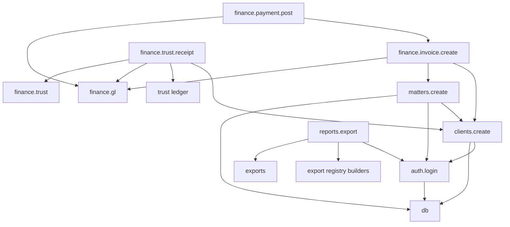

# Phase 8 workflow contracts (P8-08)

Seven LexZim v1 paths only. Source of truth: `lib/diagnostics/workflows.ts`.
Ops API: `GET /api/ops/diagnostics/workflows`. UI: `/ops/diagnostics` → Workflows.

**Trust wall:** `finance.trust.receipt` is never classified as `finance.payment.post`.

## Contracts

| Id | Module | Route | Expected | User blocker |
|----|--------|-------|----------|--------------|
| `auth.login` | `auth` | `POST /api/auth/login` | 200 | yes |
| `clients.create` | `clients` | `POST /api/clients` | 201 | yes |
| `matters.create` | `matters` | `POST /api/matters` | 201 | yes |
| `finance.invoice.create` | `finance.invoicing` | `POST /api/invoices` | 201 | yes |
| `finance.payment.post` | `finance.invoicing` | `POST /api/invoices/:id/payments` | 201 | yes |
| `finance.trust.receipt` | `finance.trust` | `POST /api/trust/ledger` (receipt) | 201 | yes |
| `reports.export` | `exports` | `GET /api/export/:kind` | 200 | no |

Invoice create inserts a **draft**. Phase 7 GL posts via `postInvoiceSentGl` when status becomes **sent**. Fee payment uses `postFeePaymentGl`. Trust receipt uses `postTrustLedgerGl`.

Compulsory KYC on `clients.create`: type, first name/surname (or registered name), phone, WhatsApp (`parseClientInput` with `requireKycCore: true`).

## Dependency graph



There is **no** edge between `finance.payment.post` and `finance.trust.receipt`.

## Suggest from an event

`suggestWorkflows({ route, module, method })` (also via query params on the workflows API):

- `/api/trust/*` never suggests fee payment
- `/api/invoices/:id/payments` never suggests trust receipt
- Module-only `finance.trust` → trust receipt only
- Module-only `finance.invoicing` → invoice create and/or fee payment (not trust)

Refresh the generated module registry after adding the workflows API route:

```bash
npm run diagnostics:registry
```
